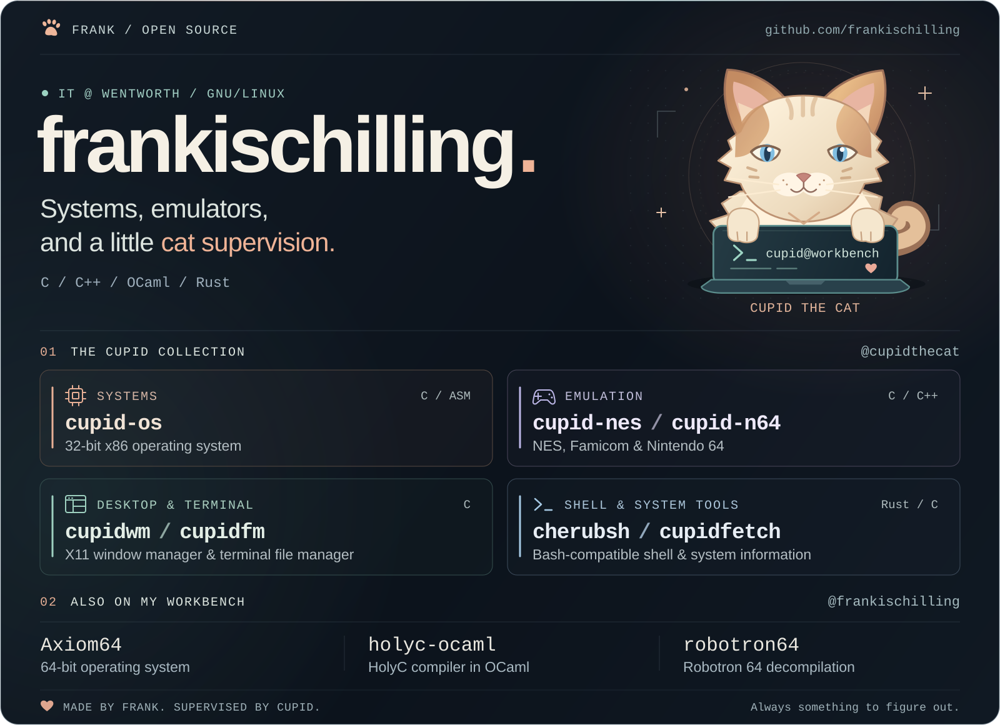

  

## Projects

Explore [Cupid the Cat](https://github.com/cupidthecat) and my [personal projects](https://github.com/frankischilling).

| Area | Projects |
| --- | --- |
| Systems | [cupid-os](https://github.com/cupidthecat/cupid-os) — 32-bit x86 hobby operating system |
| Emulation | [cupid-nes](https://github.com/cupidthecat/cupid-nes) — NES & Famicom · [cupid-n64](https://github.com/cupidthecat/cupid-n64) — Nintendo 64 |
| Desktop & terminal | [cupidwm](https://github.com/cupidthecat/cupidwm) — X11 tiling window manager · [cupidfm](https://github.com/cupidthecat/cupidfm) — terminal file manager |
| Shell & system tools | [cherubsh](https://github.com/cupidthecat/cherubsh) — Bash-compatible shell in Rust · [cupidfetch](https://github.com/cupidthecat/cupidfetch) — Linux & Windows system information |

### Other builds

| Project | Focus |
| --- | --- |
| [Axiom64](https://github.com/frankischilling/Axiom64) | 64-bit operating system in C++ and Assembly |
| [holyc-ocaml](https://github.com/frankischilling/holyc-ocaml) | HolyC compiler in OCaml |
| [robotron64](https://github.com/frankischilling/robotron64) | Matching decompilation of Robotron 64 for Nintendo 64 |
